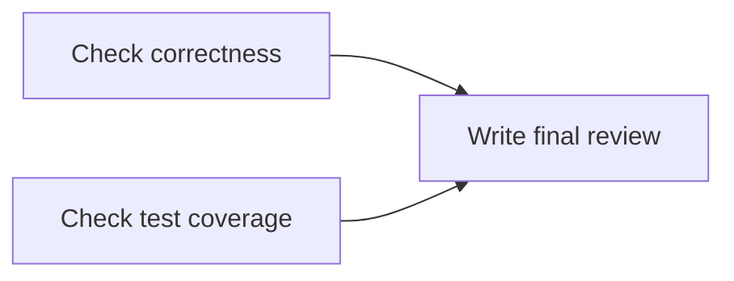
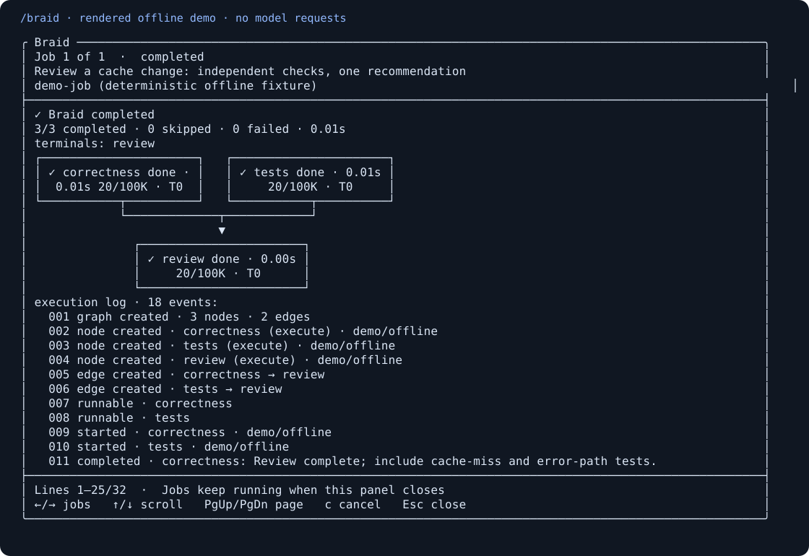

# Braid

Braid coordinates multiple LLM agents as a graph. Define each agent's task and
which results it needs; Braid runs independent tasks in parallel and passes
their outputs to the next step.

Use it as a TypeScript/JavaScript library or as a plugin for Pi or DeepSeek Harness.

[](https://github.com/Epsirom/braid/actions/workflows/ci.yml)
[](https://www.npmjs.com/package/@chrok/braid)
[](https://www.npmjs.com/package/@chrok/pi-braid)
[](https://www.npmjs.com/package/@chrok/dsh-braid)
[](LICENSE)

## Why Braid?

For a code review, one agent can check correctness while another checks test
coverage. A third waits for both results and writes the final review:



Each box is a task (a **node**); each arrow passes a result to a dependent task
(an **edge**). Braid manages when tasks run and gives each agent its own context.
For agents that edit code, it also provides separate Git worktrees; an explicit
`integrate` task applies selected changes to your checkout.

Graphs can also branch on an agent's decision, repeat work in a cycle until a
decision ends it, and be edited, rerun, or paused while running. See [runnable examples](docs/examples.md)
and [execution control](docs/execution-control.md) when you need those features.

## Get started

| Where you want to use Braid | Start here |
| --- | --- |
| In your own application | [Install `@chrok/braid`](#install-in-your-application) and supply a model runner |
| In Pi | [Install `@chrok/pi-braid`](#install-in-pi) for background agents and a live panel; `pi -p "task"` waits for background jobs in CI |
| In DeepSeek Harness | [Install `@chrok/dsh-braid`](#install-in-deepseek-harness) for background agents and a native Web graph panel |

## Install in your application

Requires Node.js 22+ and ESM imports. The core has no runtime dependencies.

```sh
npm install @chrok/braid
```

Save this as `example.mjs` and run `node example.mjs` (no API key needed):

```js
import { braid } from "@chrok/braid";
import { mkdtemp, rm } from "node:fs/promises";
import { tmpdir } from "node:os";
import { join } from "node:path";

// A non-Git directory keeps this text-only example outside workspace management.
const cwd = await mkdtemp(join(tmpdir(), "braid-hello-"));
try {
  const result = await braid({
    goal: "Try one isolated invocation.",
    nodes: [{ type: "execute", id: "answer", prompt: "Say hello." }],
    edges: [],
  }, {
    cwd,
    runner: async () => ({ output: "Hello from Braid." }),
  });
  console.log(result.terminalOutputs.answer.output);
  // Hello from Braid.
} finally {
  await rm(cwd, { recursive: true, force: true });
}
```

For a live provider, use the adapter in the API example below. Installation and
running the example above do not make model requests. In a Git checkout, Braid
creates a fresh worktree for each execution. Only explicit `integrate` nodes
write results back to the source checkout. Read [workspace behavior](#worktrees-and-merge-agents)
before running a custom adapter against a repository.

## Install in Pi

With Pi 1.2.0 and Node.js 22.19+:

```sh
pi install npm:@chrok/pi-braid
```

Run `/reload` and ask Pi to analyze a task with Braid. Background progress appears
automatically above the input editor; open `/braid` for the full live panel.
Use `/braid:review [target or focus]` for a bounded parallel review/fix loop
(at most three review rounds), and `/braid:clear` to clear the progress widget
(run it again to restore it).
npm installs the exact matching core dependency; no checkout is needed
for published versions. To try the current source checkout, follow the
[local Pi installation guide](integrations/pi/README.md#install-this-local-checkout-in-pi).



This snapshot uses the actual panel renderer and fake responses. See the
[Pi guide](integrations/pi/README.md) for background jobs, cancellation, and local
installation, and [compatibility](docs/compatibility.md) for the tested versions.

## Install in DeepSeek Harness

Requires Node.js 22.19+ and DeepSeek Harness 0.2.0-rc.2, the pinned developer-preview
host version. DSH support starts with Braid 0.3.1; the npm badge shows availability.

```sh
dsh plugin --profile web add @chrok/dsh-braid
```

Restart the profile, ask DSH to run a task with Braid, and open **Braid** in the
session header or right sidebar. Use your own profile name in place of `web`.
npm installs the matching core dependency automatically. See the
[DSH guide](integrations/dsh/README.md) for tools, live controls, the Web panel,
and installation from a local checkout.

## API

After installing the package, submit the graph in one call;
configuration and the trusted provider adapter are separate from the graph data:

```ts
import { braid } from "@chrok/braid";
import { createOpenAICompatibleRunner } from "@chrok/braid/adapters/openai";

const apiKey = process.env.OPENAI_API_KEY;
const model = process.env.BRAID_MODEL;
if (!apiKey || !model) throw new Error("Set OPENAI_API_KEY and BRAID_MODEL");

const result = await braid({
  goal: "Assess a proposed change and give a recommendation.",
  nodes: [
    {
      type: "decision", id: "route", prompt: "Choose a brief answer or a detailed assessment.",
      choices: ["brief", "detailed"], model: process.env.BRAID_ROUTER_MODEL ?? model,
    },
    { type: "execute", id: "benefits", prompt: "Assess the potential benefits." },
    { type: "execute", id: "risks", prompt: "Assess the risks and unknowns." },
    { type: "execute", id: "answer", prompt: "Use the available context to give a recommendation." },
  ],
  edges: [
    { from: "route", to: "answer", choice: "brief" },
    { from: "route", to: "benefits", choice: "detailed" },
    { from: "route", to: "risks", choice: "detailed" },
    { from: "benefits", to: "answer" },
    { from: "risks", to: "answer" },
  ],
}, {
  runner: createOpenAICompatibleRunner({ apiKey }),
  defaultModel: model,
  maxConcurrency: 4,
  nodeTimeoutMs: 60_000,
  graphTimeoutMs: 300_000,
  onEvent: event => console.log(`[${event.type}]`, event),
});

console.log(result.status, result.terminalOutputs);
```

The detailed route starts `benefits` and `risks` concurrently. The brief route
skips both, propagates their inactivity, and runs `answer` with only `route`'s
output. The graph has no special fork, branch, or join nodes.

### Graph schema

```ts
type NodePrompt = string | {
  template: string;
  variables: Readonly<Record<string, string>>;
};
type BraidInputNode =
  | { type: "execute"; id: string; prompt: NodePrompt; model?: string;
      workspace?: "read-only" | "worktree"; notifyOnCompletion?: boolean;
      requireSuccess?: boolean; pauseAfter?: boolean; maxRuns?: number }
  | { type: "decision"; id: string; prompt: NodePrompt;
      choices: readonly string[]; model?: string; workspace?: "read-only" | "worktree"; notifyOnCompletion?: boolean;
      requireSuccess?: boolean; pauseAfter?: boolean; maxRuns?: number }
  | { type: "merge" | "integrate"; id: string; prompt?: NodePrompt; model?: string;
      notifyOnCompletion?: boolean;
      requireSuccess?: boolean; pauseAfter?: boolean; maxRuns?: number };

type Edge = { from: string; to: string; choice?: string };
type BraidInput = {
  goal: string;
  nodes: readonly BraidInputNode[];
  edges: readonly Edge[];
  promptTemplates?: Readonly<Record<string, string>>;
};
```

IDs are unique, non-empty strings without `@`. Goals, models, choices, plain-string prompts,
and rendered prompts must be non-empty strings when present. Decision choices
must be non-empty and unique.
`workspace` is optional on execute/decision nodes and forbidden on merge/integrate
nodes. Both read-only and writable Git executions get isolated predecessor
snapshots; read-only disables write capabilities. Outside Git all filesystem
access is read-only. `notifyOnCompletion` requests host reminders, `pauseAfter`
holds outgoing scheduling, and `requireSuccess` makes failure abort the whole run.
All three booleans default to false. `BraidRun.holdAfter` adds or removes the
same hold on an execution that is already running. `maxRuns` caps how many
executions of a node may start, counting cycle rounds and downstream reruns
(skipped ones do not count); it is unlimited when omitted or `Infinity`, and an
owner's replacement of a started node always starts. A rerun past it waits with
`waitReason: "limit"` (see [limits](docs/execution-control.md#limits)).

Unknown fields, missing references, and duplicate edges (the same `from`, `to`,
and `choice`) are rejected. A cycle is a loop, and any edge may close one:
unconditional, nested, and overlapping cycles are allowed. A decision's choice
edge can end a cycle, and `maxRuns` on a node in it bounds its rounds; without
either it repeats until its owner stops it. Each submission or update that
creates a cycle reports it with a `cycles_created` event, and
`newCycles(graph, previous)` lists new cycles and whether anything stops them.
Disconnected components are allowed; every root runs.
Only decision nodes may have choice edges, and choices need not all have exits.

`validateGraph(input)` validates without execution. Invalid graphs raise
`GraphValidationError`; invalid options raise `TypeError`. Optional invocation
failures remain in execution history; required or infrastructure failures make
the run fail. See [execution control](docs/execution-control.md) for the complete
loop, live update, pause/resume, and failure contract.

### Reusable prompt templates

Define shared instructions once in `promptTemplates`, then give each node a
template name and explicit string variables. The same representation is accepted
by the core API and Pi's `braid` tool:

```json
{
  "goal": "Review the runtime and validation code",
  "promptTemplates": {
    "review": "Review {{target}} for {{focus}}. Inspect source and tests, then report findings with file references and supporting evidence."
  },
  "nodes": [
    {
      "type": "execute", "id": "runtime", "workspace": "read-only",
      "prompt": {
        "template": "review",
        "variables": { "target": "src/runtime.ts", "focus": "scheduling and cancellation" }
      }
    },
    {
      "type": "execute", "id": "validation", "workspace": "read-only",
      "prompt": {
        "template": "review",
        "variables": { "target": "src/validate.ts", "focus": "input validation" }
      }
    }
  ],
  "edges": []
}
```

- Placeholders use `{{name}}`, with optional surrounding whitespace inside the
  braces. Names match `[A-Za-z_][A-Za-z0-9_]*`; repeated placeholders reuse the
  same value. Template names are any non-empty strings.
- `variables` is required, including `{}` for a constant template. Values must
  be strings and must match the template's variables exactly. Empty values are
  allowed if the complete rendered prompt is still non-empty.
- Values are inserted literally once: no expressions, recursive expansion,
  escaping, environment lookup, or access to other nodes' outputs. To insert
  literal double braces into a template, pass them as a variable value.
- Unknown templates, missing/unused variables, invalid template syntax, and
  blank rendered prompts throw `GraphValidationError` before any model call.
  All declared templates are syntax-checked, including unused ones. Errors
  identify the template and, for node references/rendering, the affected node.
- Templates work on execute, decision, merge, and integrate prompts. Omitted
  merge/integrate prompts retain their defaults. Plain-string prompts are never rendered,
  even when they contain `{{...}}`.

Templates reduce duplicate text in graph/tool-call arguments; every worker still
receives its fully rendered prompt. Rendering and input snapshotting happen
before asynchronous execution. Templates are local to one submission, with no
saved registry or new runtime dependencies.

`BraidInputNode`, `NodePrompt`, and `PromptTemplateReference` describe compact
inputs. `BraidNode`, `ExecuteNode`, `DecisionNode`, `MergeNode`, `IntegrateNode`,
and `ModelRequest.node` keep their string-prompt types for runners. Core applies the
same non-empty prompt validation after rendering; it does not impose a prompt
length or token cap (see [resource limits](docs/resource-limits.md)).

### Options

| Option | Default | Meaning |
| --- | --- | --- |
| `runner` | Required | A fresh, isolated invocation for each call |
| `defaultModel` | Adapter default | Overridden by each node's `model` |
| `cwd` | `process.cwd()` | Source checkout for core-managed worktrees; non-Git directories grant read-only capabilities |
| `maxExecutions` | Unlimited | Total started and skipped executions across all rounds and updates; pending ones do not count; positive safe integer |
| `maxTokens` | Unlimited | Total reported input and output tokens across all executions, checked as executions settle; positive safe integer |
| `maxConcurrency` | `4` | Maximum simultaneous runtime-managed node invocations; positive integer |
| `nodeTimeoutMs` | Unlimited | Separate deadline for each node, starting when it runs (not while queued or suspended) |
| `graphTimeoutMs` | Unlimited | Whole execution deadline, including node queueing, paused gates, and suspensions; starts after validation |
| `onNodeTimeout` | `"pause"` (`"fail"` in `braid()`) | `"pause"` suspends a timed-out execution with its work until it is resumed or cancelled (needs an interruptible runner); `"fail"` fails it with `NODE_TIMEOUT` |
| `onLimit` | `"pause"` (`"fail"` in `braid()`) | What reaching a node's `maxRuns`, `maxExecutions`, `graphTimeoutMs`, or `maxTokens` does: `"pause"` keeps the rerun pending or pauses the run until the owner raises the limit; `"fail"` fails the run with `RUN_LIMIT`, `EXECUTION_LIMIT`, `GRAPH_TIMEOUT`, or `TOKEN_LIMIT` |
| `signal` | None | Caller cancellation signal; aborts running nodes and marks queued nodes cancelled |
| `onEvent` | None | Live observer for graph and execution creation, starts, handoffs, completions, skips, failures, and graph completion |

Every limit is unlimited by default, so a run can keep going until its graph
finishes or the owner stops it. Timeouts must be positive finite milliseconds, at
most `2_147_483_647`, or `Infinity`; `maxExecutions` and `maxTokens` take a
positive safe integer or `Infinity`. `startBraid` returns `setLimits` to change
`maxExecutions`, `graphTimeoutMs`, and `maxTokens` while the run is active; see
[limits](docs/execution-control.md#limits).

## Scheduling and routing semantics

Each node is a lineage of execution instances, `<nodeId>@<generation>`; the
latest is its head. Instance states are explicit:

```text
pending -> running -> completed | failed
pending -> skipped
```

Edges are resolved from the state of their source node's head:

| Source result | Outgoing edge state |
| --- | --- |
| Not yet finished | Unresolved |
| Completed, unlabelled edge | Active |
| Completed decision, matching choice | Active |
| Completed decision, nonmatching choice | Inactive |
| Skipped because all inputs were inactive | Inactive |
| Failed, unlabelled edge | Active (passes error and available output/workspace) |
| Failed decision, choice-labelled edge | Blocked |
| Skipped because of a failed dependency | Blocked |

Only decision nodes may have choice-labelled outgoing edges. Unlabelled edges
are unconditional, including edges from decisions. A single choice can activate
any number of edges. Choice routing requires successful decision completion.
A decision must call `decide` exactly once with exactly one declared choice;
missing, invalid, or repeated calls fail it. Catching a tool validation error
inside an adapter does not turn that invocation into a success.

A pending instance waits until **all incoming edges are resolved** and none of
its inputs is stale, that is, about to be replaced by a newer instance. Then:

1. Any blocked incoming edge makes it `skipped: upstream_failed`.
2. If it has incoming edges but none are active, it becomes `skipped: inactive`.
3. Otherwise it starts `running` (including roots, which have no inputs).

When a source settles with a new result, a settled downstream head is cloned
into a new instance, so changes cascade: a cycle unrolls one round at a time,
and rerunning a node reruns what depends on it.

Failures propagate as context through unconditional edges, allowing successors
and merge agents to inspect errors and recover partial work. Failed decisions
cannot activate choice-labelled edges; their unconditional successors can run.
There are no automatic retries. Failures are optional by default; a
`requireSuccess: true` execution failure aborts the whole run, cancels siblings,
and drains writes and cleanup. The policy belongs to the instance.
Graph deadlines and execution limits remain active while paused; reaching one
pauses the run unless `onLimit` is `"fail"`.

A pending instance is edited in place; a started one never changes and is
replaced instead. `startBraid` exposes revision-checked `update`, `resume`, `snapshot`, and
`cancel`, plus `pause`/`pauseRun`/`resumeRun` to suspend running executions at
their next model request without losing their work, `holdAfter` to hold a
running execution's result once it settles, and `setLimits` to raise run limits. Execute and decision nodes can call
`request.requestReplan` to ask the graph owner to change the plan; it holds their
result and never edits the graph itself. Updates can add, edit, replace, and
remove nodes and edges at any time before finalization: upserting a started node
replaces it and reruns its downstream lineages. See
[execution control](docs/execution-control.md) for schemas and examples.

## Execution events

The runtime keeps an immutable `events` log on every execution result and can
stream the same events through `options.onEvent`. Events are numbered and
timestamped. The log is diagnostic data and does not alter scheduling; observer
exceptions and rejected promises are ignored. Event payloads are frozen before
being retained and delivered.

The event sequence includes initial `graph_created`, `execution_created`, and
`edge_created`; revision-bearing `graph_updated`; and per-instance
`execution_created`, `node_started`, `workspace_updated`, `handoff`,
`node_completed`, `node_failed`, or `node_skipped`, plus `human_input` when an
adapter delivers a human message to a running worker. `execution_created` gives
each new instance's `generation` and `cause` (submitted, added, cloned, or
replaced); `execution_superseded` and `execution_removed` report replaced and
deleted instances. Instance events carry `executionId` and the instance's
`revision`. Handoffs also identify their exact `fromExecutionId`.

`execution_paused` and
`execution_resumed` report gates, and `execution_hold_added`/`execution_hold_removed`
changes to a running execution's hold; `replan_requested` reports a node asking
its graph owner to replan; `execution_suspending`/`execution_suspended`
report pauses of running executions, and `graph_paused`/`graph_resumed` pauses
of the whole run. `graph_waiting` reports that the last active execution
settled, was held, or suspended, and only held, suspended, or paused work
remains. `graph_completed` or `graph_failed` terminates
the log. Completion/failure is published after checkpointing. Node events repeat
with distinct execution IDs when the same definition runs again.

Use `startBraid` methods to control a run. Event callbacks are observers; throwing
or rejecting does not change scheduler behavior. The Pi panel displays current
topology, iterations, pause gates, and a bounded event preview; complete history
remains available in the result.

### Live execution activity

Lifecycle events say when an invocation starts and ends, not what it is doing in
between. `ExecutionActivityTracker` is an optional, host-neutral helper for
adapters that want to show that. Feed it core events with `observe(event)`, give
each runner invocation `tracker.recorder(request)`, and call
`workerFinished(executionId)` after the runner returns. The recorder accepts model
requests, stream deltas, responses, errors, and tool start/output/end calls.
`get(executionId, { before, limit })` returns one invocation's current phase
(`workspace`, `worker`, `model`, `tool`, `finalizing`, `completed`, or `failed`),
when that phase began, the last observed signal, the in-flight model request and
running tools, declared host `limitations`, and a page of chronological entries.
Histories are keyed by execution ID, so repeated loop visits stay separate.
Entries and details are bounded (200 entries and 2,000 characters per detail by
default); finished invocations beyond the newest 50 keep only their summary.
`formatActivityStatus(activity, now)` renders a one-line summary. Recorder calls
never throw and do not change scheduling or results. Time without new activity is
a diagnostic signal, not a stall verdict.

## Context isolation and model runners

The core accepts a `ModelRunner` function with this contract:

```ts
import type { ModelRequest } from "@chrok/braid";

type ModelRunner = (request: ModelRequest) => Promise<{
  output: string;
  model?: string;
  usage?: { inputTokens: number; outputTokens: number };
}>;
```

Each request contains the goal, node, resolved model, predecessor outputs,
execution IDs, and an abort signal. Decision nodes additionally receive
`request.decide(choice)`. Expose that callback as an actual model tool; do not
infer decisions by parsing the model's prose. Core assigns `request.workspace`,
provides local `request.git(args, input?)` operations in Git repositories, and
provides `request.merge.sources` and `request.merge.finish(dispositions)` to
merge agents. Adapters must enforce workspace capabilities and wrap mutating
file tools in `request.withWorkspaceWrite(operation)`, so cleanup waits for
in-flight writes and rejects later writes. Core Git mutations use this barrier.
Adapters that let a human message a running worker call
`request.recordHumanInput(text)` when they deliver it, before the model request
that includes it. Core records it in the execution's `humanInputs` and as a
`human_input` event, so results show that the execution did not run from its
graph definition and predecessor inputs alone; it throws once the invocation
has ended.
To support pausing, set `pausable: true` on the runner function and await
`request.checkpoint()` before each model request; it suspends the invocation
there while a pause is active. Read `request.deadlines` each time rather than
copying it, because a suspension moves the node deadline later
(see [pausing running executions](docs/execution-control.md#pausing-running-executions)).
The included Pi adapter provides guarded `write`/`edit` and Pi shell tools alongside its read tools.
For read-only workspaces, adapters must omit mutating tools; the core write
barrier also rejects writes. This includes all nodes outside Git. Writable Pi nodes
can use `bash` (and `powershell` on Windows) to build and run tests. Shell calls
participate in the write barrier and forward cancellation to their processes.

`request.predecessors` contains direct active predecessors in incoming-edge
order, including failures on unconditional edges with an `error` field. Each source appears once:

```json
[{ "nodeId": "route", "output": "Use a detailed comparison.", "decision": "detailed", "model": "router" }]
```

There is no parent conversation, global transcript, or automatic transitive
history. Each invocation gets fresh node/context objects, so modifying them
cannot affect the graph, another node, or recorded results. Both the submitted
input and options are snapshotted before asynchronous execution. Core manages
worktrees for all adapters; adapters decide which tools expose those capabilities.
Read tools follow the host filesystem permissions and are not a security sandbox.

### Worktrees and merge agents

Every Git execution owns a fresh worktree. Roots use the job's initial snapshot
of tracked edits and non-ignored untracked files without changing the real index.
Successors use immutable predecessor checkpoints; read-only executions use the
same snapshot rules with writes disabled. Independent code branches require an
explicit merge before an ordinary worker consumes them together.

- `merge` combines selected predecessor checkpoints in a **new isolated worktree**.
- `integrate` applies selected results to the **invoking working checkout**.

There is no automatic final integration. Add an explicit integrate node when
results should reach the working branch. Both operations accept optional prompts
and require `finish_merge` with exactly one disposition per source:

```json
{ "dispositions": [
  { "executionId": "<source-execution-id>", "disposition": "integrated", "reason": "Applied the reviewed checkpoint" }
] }
```

The agent chooses merge, cherry-pick, apply, restore, or file edits; core never
chooses for it. Sources include bounded diffs relative to the initial job
snapshot. Integrate also receives the current source checkout's dirty status and
must preserve unrelated user changes. Unresolved conflicts, a missing finish
call, or an `archived` disposition fail the operation.

The model-facing Git tool separates `command` from `args`, for example
`{ "command": "show", "args": ["REF:path"] }`. The programmatic `request.git`
accepts the complete argument array. Duplicate command prefixes, network Git,
branch switching, and filesystem-boundary overrides are rejected.

Instances checkpoint tracked changes and non-ignored new files before downstream
admission. Ignored dependencies, caches, and build products are discarded on cleanup;
files already tracked or explicitly force-added remain tracked under normal Git rules.
All source checkpoints remain
reusable; no merge consumes or deletes a predecessor's result. Job cleanup
archives and removes owned worktrees, retaining refs under
`refs/braid/checkpoints/`. Integration additionally captures a pre-write
`backupRef` under `refs/braid/merge-backups/`. Target workspace `dispositions`
record the agent's source selections.

`result.workspaces` is keyed by execution ID; `result.nodes[id].workspace` is the
latest convenience view. Cleaned paths are historical; recover their contents
with `git show <checkpointRef>:path` or inspect changes with
`git diff <snapshotCommit> <checkpointRef>`. Remove reviewed refs explicitly with
`git update-ref -d <ref>`.

Cancellation drains tracked writes before cleanup. Checkpoint/cleanup failures
fail the run and retain unsafe-to-remove paths. Failed integration may leave
partial source edits or conflict state with its backup available for recovery;
it does not reset the checkout. Source integrations serialize within one process;
this does not coordinate parent edits or other processes. Read-only workers remain
isolated from those source edits. See [execution control](docs/execution-control.md).

**The adapter is a trust boundary, not a security sandbox.** It must avoid shared
conversation state, expose only its declared capabilities, and forward `signal` to its provider.
The core does not supply shell tools or a recursive Braid tool; adapters choose
their tool capabilities. The Pi adapter supplies shell tools to writable nodes
without changing the runtime; the core package does not depend on Pi. See
[`integrations/pi/README.md`](integrations/pi/README.md) for installation and testing.

The included OpenAI-compatible adapter uses fresh Chat Completions contexts,
a strict `decide({ choice })` tool and one tool-free continuation for decisions.
Merge/integrate nodes use a local `git` / `finish_merge` tool loop; ordinary OpenAI nodes
have no filesystem tools. Pi exposes read, guarded write, and shell tools plus
these core Git/merge tools. Tool errors go back to nodes for recovery. Both
adapters sum usage across their model calls and forward cancellation.
Pi writes reject external paths, Git metadata, symlinks, hard links, and special
files. Shell tools can bypass these checks and run with host permissions; prompts
require nodes to respect workspace boundaries, shared Git state, and external
resources. Parent extension/MCP tools and hooks are not inherited. These checks
and cooperation rules are not an OS sandbox.
See the [Pi filesystem capabilities](integrations/pi/README.md#node-filesystem-capabilities).

Pi tool and time budgets are unlimited by default. Its `options.maxToolRounds`
and `options.maxToolCalls` can impose positive integer limits per node; counts
include `decide` and rejected requests. Exceeding either limit fails the node
before executing the over-budget batch. Returning final text at the limit is
allowed. See the [Pi budget options](integrations/pi/README.md#node-filesystem-capabilities)
for configuration, including `nodeTimeoutMs` and `graphTimeoutMs`.

For finite budgets, Pi inserts a system reminder with remaining tool and time
budgets before every model call. The OpenAI-compatible adapter also refreshes
finite time-budget reminders before each request. The core supplies optional
`request.deadlines` on the `performance.now()` clock for adapters to calculate
remaining node and shared graph time. Reminders do not extend hard limits or
interrupt a model response already in progress. The core API sets no node or
graph timeout unless you pass one.

## Results, timeouts, and accounting

`BraidResult` contains:

- `status`: `completed` or `failed`.
- `terminalOutputs`: latest successful unconsumed outputs keyed by node ID.
- `terminalExecutionIds`: exact IDs of the successful execution endpoints.
- `nodes`: latest states/results per node ID, including output, error, usage,
  timing, and workspace metadata. A pending definition has no execution ID yet.
- `executions`: all immutable invocation definitions and their final results,
  keyed by execution ID, including historical rounds and deleted definitions.
- `revision`: the last committed graph revision.
- `workspaces`: execution-keyed workspace states, recovery refs, and merge choices.
- `events`: the immutable execution log described above. `onEvent` observes live
  copies of the same state transitions while the run is in progress.
- `metadata`: run/root identity, timestamps, monotonic latency, summed reported
  token usage, and `usageReportedNodes`. Missing usage is unknown, not proof of
  zero consumption. Usage counts only what the runner actually returns; a
  timeout or provider error may leave billable usage unavailable.
- `error`: one representative error when failed; `nodes` retains all errors.

With `startBraid` and an interruptible runner (Pi, DSH, and the OpenAI-compatible
adapter are), a node timeout pauses the execution instead: it keeps its work and
its successors wait until it is resumed, with a new time budget, or cancelled with
`cancelExecutions`. See [pausing on node timeout](docs/execution-control.md#pausing-on-node-timeout).
Otherwise, and always with `braid()` or `onNodeTimeout: "fail"`, a node timeout
marks the running node `failed: NODE_TIMEOUT`; unconditional successors can
consume its error and partial workspace. A graph timeout pauses a `startBraid`
run and its running executions until `setLimits` raises it (see
[limits](docs/execution-control.md#limits)). With `braid()` or `onLimit: "fail"`,
it marks running nodes `failed: GRAPH_TIMEOUT`, skips queued/pending nodes with
`graph_timeout`, and retains already completed terminal outputs. Timers are
cleared when no longer needed.

Timeouts abort the invocation signal and stop waiting for the model even if it
ignores cancellation. Workspace setup, tracked writes, and cleanup are awaited
to avoid deleting work still being written; this may extend total wall time. Late settlements cannot change the returned results, and late
rejections are observed. JavaScript cannot forcibly preempt synchronous work or
stop an uncooperative remote request: providers must honor cancellation to stop
resource consumption. Concurrency limits cover runtime-managed invocations;
uncancelled provider work after timeout can outlive a slot.

## Develop from source

```sh
git clone https://github.com/Epsirom/braid.git
cd braid
npm ci
npm run check
npm test
npm run build
npm run demo
```

The demo uses a deterministic fake model runner and makes no network calls. To
run the same graph with an OpenAI-compatible Chat Completions endpoint:

```sh
# Set OPENAI_API_KEY and BRAID_MODEL in your environment first.
npm run demo -- --live
```

`OPENAI_BASE_URL` optionally changes the API root (for example,
`https://your-provider.example/v1`). Live mode makes billable model requests.
The adapter requires a model with function/tool calling support. No live provider
is needed for the test suite; its HTTP requests are intercepted in tests.

## Internal architecture and scope

- [`src/types.ts`](src/types.ts): public graph, provider, and result types.
- [`src/validate.ts`](src/validate.ts): strict validation, graph snapshot,
  dependency indexes, and iterative validation of acyclic regions and cycles.
- [`src/runtime.ts`](src/runtime.ts): lineages of execution instances, edge resolution, explicit state transitions,
  bounded concurrent scheduling, invocation deadlines, execution events, and result accounting.
- [`src/workspaces.ts`](src/workspaces.ts): Git snapshots, checkpoint refs, merge
  serialization, local Git tools, and worktree cleanup.
- [`src/adapters/openai.ts`](src/adapters/openai.ts): optional provider translation.
- [`integrations/dsh/`](integrations/dsh/): native DeepSeek Harness model/tool adapter, agent-scoped jobs, reminders, and a native Web graph panel.
- [`integrations/pi/`](integrations/pi/): thin Pi model-registry/tool adapter, Mermaid graph renderer, and live execution renderer (`display.ts`).
- [`test/`](test/): deterministic scheduling, execution-event, and intercepted HTTP/tool tests.

There is one in-memory execution context per run, plus a process-local mutex
per source checkout for integrate agents. Worktree registration and removal are
serialized per common Git directory within the process; model calls remain
concurrent. These locks do not coordinate other processes. `rootRunId` equals
`runId`. Centralized invocation admission and
usage aggregation leave places to thread a shared root budget in a future
nested-run implementation; **nested runs and shared budget enforcement are not
implemented**. The current scheduler deliberately rescans a small graph after
completions; `onEvent` is an observer for diagnostics and visualization, not a
scheduler event bus.

Out of scope: arbitrary
code nodes, durable workflow recovery, saved templates, a graphical editing UI,
and recursive Braid calls from model nodes. The RSI Mode and Zen Mode milestones
revisit some of these boundaries; see [ROADMAP.md](ROADMAP.md#milestones).

## Releases and upgrades

The 0.5 API is experimental. See [GitHub releases](https://github.com/Epsirom/braid/releases)
for release and upgrade notes.

- Upgrading from 0.5: read the [0.5 → 0.6 migration guide](docs/compatibility.md#migrating-from-05-to-06).
- Upgrading from 0.4: also follow the [0.4 → 0.5 migration guide](docs/compatibility.md#migrating-from-04-to-05).
- Upgrading from 0.3: also follow the [0.3 → 0.4 migration guide](docs/compatibility.md#migrating-from-03-to-04).
- Upgrading from 0.2: also follow the [0.2 → 0.3 migration guide](docs/compatibility.md#migrating-from-02-to-03).
- Upgrading from 0.1: also follow the [0.1 → 0.2 guide](docs/compatibility.md#migrating-from-01-to-02).
- Using the previous release: see the [0.5.1 documentation](https://github.com/Epsirom/braid/tree/v0.5.1).

## Contributing and project status

Start with [CONTRIBUTING.md](CONTRIBUTING.md) for setup and verification,
[ROADMAP.md](ROADMAP.md) for scope, and [GitHub releases](https://github.com/Epsirom/braid/releases) for changes.
See [compatibility](docs/compatibility.md), [resource limits](docs/resource-limits.md),
and [scheduler benchmarks](docs/benchmark.md) before adopting Braid for a service.
Questions and bugs belong in [GitHub issues](https://github.com/Epsirom/braid/issues);
report vulnerabilities privately as described in [SECURITY.md](SECURITY.md).
Participation follows the [code of conduct](CODE_OF_CONDUCT.md).

## License

Braid is released under the [MIT License](LICENSE).
